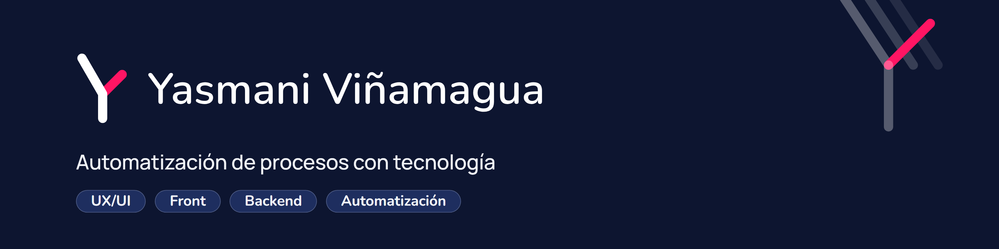

  

# Marca personal · Yasmani Viñamagua

Identidad visual de la marca personal de Yasmani Viñamagua, ingeniero especializado en innovación y automatización de procesos mediante tecnología. Este repositorio reúne el logotipo, el manual de identidad, la paleta, las aplicaciones y los vídeos de animación del logo.

**Versión actual:** v1.1 (ajuste de la v1.0, octubre de 2026).

## Concepto

- Monograma **A + Y** (iniciales de Angel Yasmani) de trazo monolínea con terminales redondeados.
- Valores: responsabilidad, honestidad y lealtad.
- Personalidad: innovadora y tecnológica, confiable y sobria.

## Paleta

| Color | HEX | Rol |
|---|---|---|
| Azul marino | `#223367` | Principal |
| Rosa | `#FF1563` | Acento de firma |
| Medianoche | `#0D1530` | Fondos oscuros |
| Pizarra | `#5B6478` | Texto secundario |
| Niebla | `#F2F4F8` | Fondos claros |
| Blanco | `#FFFFFF` | Fondo y negativo |

El nombre se compone en **Nunito SemiBold**. Los tintes de apoyo y las reglas de contraste están en [`elementos-manual-identidad/paleta/paleta.md`](elementos-manual-identidad/paleta/paleta.md).

## Estructura

| Carpeta o archivo | Contenido |
|---|---|
| [`elementos-manual-identidad/logo/`](elementos-manual-identidad/logo/) | Logotipo en SVG y PNG: color, negativo, una tinta, horizontal, vertical e iconos. `logo-master.svg` es el maestro. `exploracion/` guarda el proceso de diseño. |
| [`elementos-manual-identidad/manual/`](elementos-manual-identidad/manual/) | Manual de identidad en HTML y Markdown, y la nota de transición v1.0 → v1.1. |
| [`elementos-manual-identidad/paleta/`](elementos-manual-identidad/paleta/) | Colores con HEX, RGB, CMYK y Pantone de referencia, y tabla de contrastes. |
| [`elementos-manual-identidad/aplicaciones/`](elementos-manual-identidad/aplicaciones/) | Maqueta de las aplicaciones de la marca y sus recursos gráficos. |
| [`guias-manuales/`](guias-manuales/) | Plantillas HTML (A4, estilo APA 7) exportables a PDF para manuales: portada, índice, página de contenido y página final. |
| [`manuales/`](manuales/) | Manuales de estudio generados con la skill `/manual-notion` a partir de páginas de Notion: **Python: de lo básico a lo avanzado** y **Git y GitHub**. Cada carpeta trae el HTML, el PDF, la estructura y las fuentes. |
| [`videos/`](videos/) | Animaciones del logo (horizontal y vertical) como proyectos [HyperFrames](https://github.com/heygen-com/hyperframes). |
| [`banners/`](banners/) | Banners para GitHub (`banner-github.png`, 3168 × 792), LinkedIn (`banner-linkedin.png`, 1584 × 396, con el contenido desplazado para no quedar bajo la foto de perfil), Figma Community (`banner-figma.png`, 1920 × 640) y portada de Notion (`banner-notion.png`, 3000 × 600, panorámica con los chips a la derecha para que la foto de perfil no los tape), exportados desde `banner.html` con el lockup negativo, la línea de apoyo y el recurso de flujo. |
| [`web/`](web/) | Sitio web personal en HTML, CSS y JS planos: inicio, proyectos, ficha de proyecto y recursos (manuales en PDF descargables desde `web/guias/`, videos propios y recomendados con miniatura: videos y extensiones de Chrome). Tema claro y oscuro, fuentes Nunito y Manrope en `woff2`, menú hamburguesa en móvil, tooltips accesibles, animaciones al entrar en cada sección y formulario que abre WhatsApp. Abre `web/index.html` para verlo. |
| [`PRODUCT.md`](PRODUCT.md) · [`DESIGN.md`](DESIGN.md) | Contexto de producto y sistema de diseño de la web. |
| [`web/user-flow/`](web/user-flow/) | Estructura y flujo de usuario del sitio (`user-flow.md`). |
| [`marca-spec.md`](marca-spec.md) | Especificación de la marca: brief, decisiones y fases aprobadas. |
| [`.yas/`](.yas/) | Informes de auditoría y configuración de Yas Design. |
| [`.agents/`](.agents/) · [`.claude/`](.claude/) | Skills de Yas Design usadas para crear y auditar la marca. |

## Skills utilizadas

Skills de Claude Code con las que se creó, auditó y documentó la marca. Las propias son de Yasmani; las de terceros se instalaron tal cual desde su repositorio (versiones fijadas en [`skills-lock.json`](skills-lock.json)).

| Skill | Qué hace | Propiedad |
|---|---|---|
| `/yas-design` | Crea la identidad: estrategia de marca o rebranding, logotipo y manual de identidad, documentando cada decisión en archivos del proyecto. | Propia · [yas-design-system](https://github.com/Yasmani-Vinamagua/yas-design-system) |
| `/yas-audit` | Audita una marca (estrategia, identidad visual y verbal, consistencia, presencia digital y activos) y entrega un informe con puntuación sobre 20. Solo diagnostica. | Propia · [yas-design-system](https://github.com/Yasmani-Vinamagua/yas-design-system) |
| `/yas-figma` | Genera el design system a partir del manual de identidad y lo lleva a Figma, o a un HTML entregable si no hay MCP de Figma. | Propia · [yas-design-system](https://github.com/Yasmani-Vinamagua/yas-design-system) |
| `yas-core` | Núcleo compartido: reglas comunes, artefactos, especificación de tokens y criterios de calidad que leen las otras tres. No se invoca directamente. | Propia · [yas-design-system](https://github.com/Yasmani-Vinamagua/yas-design-system) |
| `/manual-notion` | Convierte páginas de Notion en un manual académico A4 (portada, índice, capítulos en APA 7 y página final) y lo exporta a PDF. | Propia · local en `.claude/skills/` |
| `design-taste-frontend` | Dirección de arte para sitios web: aplica un estilo anti-genérico, con inspección en navegador y ciclo de revisión sobre capturas. Se usó en la web. | Terceros · [Leonxlnx/taste-skill](https://github.com/Leonxlnx/taste-skill) |

## Pendiente

En la web, el contenido de los proyectos es provisional y falta sustituirlo por casos reales. En Recursos ya hay dos manuales, tres videos propios y siete recomendados; quedan como ejemplo dos guías y un video (los elementos que prueban el carrusel móvil). Las pruebas físicas de tamaño mínimo de impresión y la validación legal siguen abiertas. Los valores CMYK y Pantone son de referencia y deben confirmarse con una prueba impresa.

## Licencia

[MIT](LICENSE) © 2026 Angel Yasmani Viñamagua Cuenca
