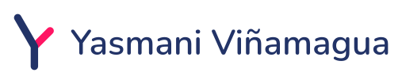
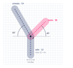

# Manual de identidad visual — Yasmani Viñamagua

**Versión 1.1 · 2026-10-21** · Marca personal de ingeniería y automatización

> Este manual reúne las reglas de uso de la marca. Todas las decisiones están justificadas en `marca-spec.md`. La versión 1.1 es un ajuste de la 1.0 a partir de la auditoría del 2026-10-21 (`.yas/audits/2026-10-21-marca.md`): cambia la ejecución de los archivos y algunas reglas, no el concepto.

---

## 1. Introducción

**La marca.** Yasmani Viñamagua es un ingeniero que se posiciona en **innovación y automatización de procesos mediante el uso de la tecnología**.

**Público.** Clientes y empresas (principal) y empleadores y reclutadores (secundario).

**Valores.** Responsabilidad, honestidad y lealtad.

**Personalidad.** Innovadora y tecnológica, confiable y sobria.

**Concepto del logotipo.** *Dos flujos que confluyen en uno, con una rama que abre una nueva vía.* La **entrada** es el flujo que llega, el **tallo** es el proceso que continúa y la **rama** (en rosa) es la derivación: la automatización y la innovación.

**Nombre.** Se escribe siempre **"Yasmani Viñamagua"**, con ñ y con mayúscula inicial en ambas palabras. El título profesional no va delante del nombre y el logotipo no lleva descriptor.

**Línea de apoyo.** «Automatización de procesos con tecnología». Va siempre **fuera del logotipo**, en Manrope Medium (Niebla sobre Medianoche, 16,34; Pizarra sobre Niebla, 5,39). Se usa en el banner de LinkedIn y en la portada web; en tarjeta y firma no es obligatoria.

**Origen.** Rediseño de la marca personal "AY" (2023). Se conservaron el trazo monolínea con terminales redondeados y la paleta azul marino y rosa; el símbolo pasa a ser una **Y**, coherente con el nombre público.

---

## 2. El logotipo



### Anatomía
| Parte | Descripción |
|---|---|
| **Símbolo** | Una Y asimétrica formada por la **entrada** (brazo largo, azul), el **tallo** (azul) y la **rama** (rosa, por debajo de la entrada). |
| **Nombre** | "Yasmani Viñamagua" en Nunito SemiBold 600 a 44 u, convertido a trazados con las curvas de la fuente (sin `<text>`). |
| **Lockup** | Símbolo y nombre combinados, en versión horizontal (símbolo al 78 % de su tamaño, nombre centrado respecto al símbolo) o vertical. |

### Regla de capas
La **rama rosa va siempre por debajo** de la entrada azul: en la unión, el azul se superpone al rosa.

---

## 3. Construcción



| Parámetro | Valor |
|---|---|
| Lienzo | 100 × 100 |
| Unidad `u` | 4 |
| Grosor de trazo | 12 = 3u (terminales redondos, radio 6) |
| Punto de unión **J** | (46, 56) |
| **Entrada** | 60° respecto a la horizontal, hacia arriba a la izquierda; longitud 54 |
| **Rama** | 45° hacia arriba a la derecha; longitud 36 |
| **Tallo** | Vertical hacia abajo; longitud 32 |

> **Archivo (v1.1):** el símbolo son dos contornos con arcos exactos (entrada y tallo en uno, rama en otro) con esta misma geometría; el nombre usa las curvas de Nunito, con cada letra en la posición de v1.0. El maestro es `logo/logo-master.svg`, con los grupos `simbolo` y `nombre`. El diagrama `construccion.svg` se mantiene.

---

## 4. Versiones

| Versión | Archivo | Cuándo usarla |
|---|---|---|
| Maestro | `logo/logo-master.svg` | Fuente de referencia (lockup horizontal en color) |
| Símbolo en color | `logo/logo-color.svg` | Fondos claros, avatar, iconos |
| Símbolo negativo | `logo/logo-negativo.svg` | Fondos oscuros (Medianoche) |
| Símbolo una tinta negra | `logo/logo-1tinta-negro.svg` | Sellos, prensa, grabado, bordado, vinilo |
| Símbolo una tinta blanca | `logo/logo-1tinta-blanco.svg` | Sobre fondos oscuros en una tinta |
| Horizontal | `logo/logo-horizontal-*.svg` | Cabeceras, firma, web, documentos |
| Vertical | `logo/logo-vertical-*.svg` | Portadas, carteles, formatos cuadrados |
| Avatar | `logo/icono-avatar.svg` | LinkedIn y redes |
| Favicon | `logo/icono-favicon.svg` | Pestaña del navegador y tamaños de 32 px o menos (trazo reforzado) |

Los lockups tienen cuatro variantes cada uno: `color`, `negativo` (con fondo Medianoche), `1tinta-negro` y `1tinta-blanco`. Hay copias en PNG de 1600 px de ancho en `logo/png/`. Los nombres conservan el patrón `logo-horizontal-*` y `logo-vertical-*` (una por versión de color), `icono-avatar.svg` e `icono-favicon.svg`.

---

## 5. Área de respeto y tamaño mínimo

**Área de respeto:** el **25 % de la altura del símbolo**, tal como aparece en cada versión, por todos los lados. Los lockups ya la incluyen en su `viewBox` (en el horizontal, con el símbolo al 78 %, equivale a ≈ 17,7 u).

| Versión | Pantalla (probado) | Impresión (provisional, sin prueba física) |
|---|---|---|
| Símbolo solo | 24 px de alto | 6 mm de alto |
| Favicon reforzado | 16 px | — |
| Lockup horizontal | 120 px de ancho | 30 mm de ancho |
| Lockup vertical | 110 px de ancho | 28 mm de ancho |

Probado en pantalla (render de Chrome a 1×): símbolo a 32, 24, 20, 16 y 12 px; lockup horizontal a 160, 140, 120, 100 y 90 px (a 100 px se lee con reservas); lockup vertical a 130, 110, 100, 90 y 80 px. Los valores de impresión son provisionales hasta imprimir una prueba. Por debajo de esos tamaños se usa el símbolo solo o el favicon reforzado.

---

## 6. Usos incorrectos

No se debe:
1. **Deformar** el logotipo (estirarlo o comprimirlo).
2. **Girarlo** o espejarlo.
3. **Cambiar los colores** ni usar colores fuera de la paleta (por ejemplo, el naranja de la marca anterior).
4. **Añadir sombras, efectos, degradados o contornos.**
5. **Poner la rama rosa por encima** de la entrada azul.
6. **Usarlo sobre fondos de bajo contraste** (por ejemplo, la versión en color sobre azul marino).
7. **Cambiar la tipografía del nombre** o reescribirlo con otro formato.
8. **Separar el símbolo y el nombre** en un lockup oficial ni cambiar su distancia.
9. **Añadir un descriptor o título** al lockup. La línea de apoyo va fuera del logotipo.
10. **Usar Línea o Bruma como color de texto**, ni el recurso de flujo mayor que el 60 % de la altura de la pieza.

---

## 7. Color

| Color | Función | HEX | RGB | CMYK* | Pantone aproximado** |
|---|---|---|---|---|---|
| **Azul marino** | Principal (símbolo, títulos) | `#223367` | 34 / 51 / 103 | 67 / 50 / 0 / 60 | Entorno de 2767 C o 281 C |
| **Rosa** | Acento firma (rama, resaltes) | `#FF1563` | 255 / 21 / 99 | 0 / 92 / 61 / 0 | Entorno de 192 C o 1925 C |
| **Medianoche** | Fondos oscuros, portadas | `#0D1530` | 13 / 21 / 48 | 73 / 56 / 0 / 81 | Entorno de 2767 C o negro 6 C |
| **Pizarra** | Texto secundario | `#5B6478` | 91 / 100 / 120 | 24 / 17 / 0 / 53 | Entorno de 431 C |
| **Niebla** | Fondos claros | `#F2F4F8` | 242 / 244 / 248 | 2 / 2 / 0 / 3 | Entorno de Cool Gray 1 C |
| **Blanco** | Fondo y negativo | `#FFFFFF` | 255 / 255 / 255 | 0 / 0 / 0 / 0 | — |
| **Línea** (v1.1) | Divisores y bordes finos (solo decorativo) | `#E3E7F0` | 227 / 231 / 240 | 5 / 4 / 0 / 6 | pendiente de definir |
| **Bruma** (v1.1) | Tonos del recurso y trazos de apoyo (solo decorativo) | `#C9D0E6` | 201 / 208 / 230 | 13 / 10 / 0 / 10 | pendiente de definir |

\* Navy y rosa: valores del manual anterior. El resto: conversión matemática, no perfil ICC; validar con prueba impresa. Línea y Bruma se añadieron en v1.1 (ya se usaban sin declarar); son solo de pantalla y no se usan para texto ni bordes de componentes. Detalle y contrastes en `paleta/paleta.md`.
\** Pantone: **aproximación no verificada**; confirmar con guía física (*Solid Uncoated* para papel natural).

### Justificación
- **Azul marino:** seriedad y confianza (responsabilidad y honestidad); es el ancla de la marca y se mantiene de la identidad anterior.
- **Rosa:** el color de la innovación y el acento firma; ocupa un **hueco** en el sector (la automatización y las redes usan sobre todo azul, rojo y naranja). *Esta lectura del sector viene de conocimiento general y no está verificada con los manuales de otras marcas.*
- **Sin naranja:** se eliminó para no caer en el naranja habitual del software de automatización y para simplificar la paleta.

### Contraste (WCAG 2.x, calculado)
| Combinación | Ratio | Uso permitido |
|---|---|---|
| Azul marino sobre blanco | 12,09 | Texto y logo |
| Azul marino sobre Niebla | 10,98 | Texto y logo |
| Blanco sobre azul marino | 12,09 | Texto y logo en negativo |
| Blanco sobre Medianoche | 17,99 | Texto y logo en negativo |
| Niebla sobre Medianoche | 16,34 | Texto sobre fondo oscuro, línea de apoyo |
| Rosa sobre Medianoche | 4,75 | Texto normal y acentos |
| Pizarra sobre blanco | 5,93 | Texto secundario |
| Pizarra sobre Niebla | 5,39 | Texto secundario |
| Rosa sobre blanco | **3,79** | **Solo gráficos y texto grande** |
| Blanco sobre rosa | **3,79** | **Solo texto grande** |
| Rosa sobre Niebla | **3,44** | **Solo gráficos y texto grande** |
| Rosa sobre azul marino | **3,19** | **Solo gráficos grandes** |
| Pizarra sobre Medianoche | **3,03** | **No para texto normal; solo gráficos o texto grande** |
| Línea sobre blanco / Niebla · Bruma sobre blanco / Niebla | 1,24 / 1,12 · 1,54 / 1,40 | **Solo decorativo** |

### Proporción de uso
**60 %** neutros (blanco, Niebla, Medianoche) · **30 %** azul marino · **10 %** o menos rosa.

### Degradado (opcional, recurso gráfico)
De `#223367` al 31 % a `#FF1563` al 91 %, horizontal. Solo en fondos y barras, siempre con un color sólido de reserva. **No se usa en el logotipo.**

---

## 8. Tipografía

| Uso | Fuente y peso | Tamaño / interlineado (web) | Color |
|---|---|---|---|
| Nombre en logotipo | Nunito SemiBold 600 | Según lockup | Azul marino |
| Título 1 | Nunito ExtraBold 800 | 40 / 48 px | Azul marino |
| Título 2 | Nunito Bold 700 | 28 / 36 px | Azul marino |
| Subtítulo | Nunito SemiBold 600 | 20 / 28 px | Azul marino |
| Párrafo | Manrope Regular 400 | 16 / 26 px | Medianoche |
| Texto secundario | Manrope Medium 500 | 14 / 22 px | Pizarra |
| Línea de apoyo | Manrope Medium 500 | Según pieza | Niebla sobre Medianoche · Pizarra sobre Niebla |
| Etiqueta | Manrope Medium 500, versalitas, +0,14 em | 13 / 18 px | Pizarra |
| Cifras y datos | Manrope Bold 700 | 16 px | Azul marino |

- **Licencia:** ambas fuentes están en Google Fonts con licencia abierta (SIL OFL); **verificar en cada ficha** antes de un uso comercial.
- **Alternativa:** `"Segoe UI", system-ui, sans-serif` cuando no estén disponibles.
- **Justificación:** Nunito tiene **terminales redondos**, igual que el símbolo; Manrope es neutra, legible y precisa para párrafos y cifras. Se sustituye Montserrat (terminales planos).
- **Reglas:** máximo dos familias y cuatro pesos por documento; no estirar ni aplicar efectos al texto del logotipo.

---

## 9. Aplicaciones

Composiciones de ejemplo en `aplicaciones/aplicaciones.html`: LinkedIn (banner y avatar), tarjeta de visita, firma de correo, portada de memoria técnica, documento interior, presentación y sitio web. Los datos son de ejemplo. La línea de apoyo aparece en el banner de LinkedIn y en la portada web.

---

## 10. Estructura gráfica y recursos

**Líneas de flujo** (`aplicaciones/recurso-flujo.svg` y `recurso-flujo-oscuro.svg`): derivan de la geometría del símbolo. Son líneas a 60° que convergen (tonos de azul o blanco con transparencia, o Bruma) y una **rama rosa a 45°**.

**Reglas (medibles desde v1.1):** un solo recurso por pieza, anclado a una esquina, de como máximo el **60 % de la altura de la pieza**, siempre dentro de la paleta, y sin tocar texto ni el área de respeto del logotipo.

**Elementos de apoyo:** barra rosa corta (3 a 5 px, terminales redondos) como firma, resaltado rosa bajo la palabra clave (nunca texto en rosa sobre blanco) y viñetas rosa.

---

## 11. Entregables y contacto

### Archivos
```
logo/                 SVG de todas las versiones, logo-master.svg y construccion.svg
logo/png/             PNG de 1600 px de ancho
paleta/               paleta.md: colores, tintes y contrastes
aplicaciones/         composiciones de ejemplo y recursos
manual/               este manual (Markdown y HTML)
marca-spec.md         decisiones y justificaciones por fase
```

### Pendientes y limitaciones
- **Verificar Pantone** con guía física y probar los mínimos de impresión (provisionales) con una prueba real, incluida la rama fina a tamaños pequeños.
- **Búsqueda de anterioridades** en propiedad intelectual antes de registrar la marca (la diferenciación frente a otras marcas sigue sin verificar).
- **Kerning:** se conservan los ajustes manuales de v1.0 en "Ya" y "Vi"; revisar al ampliar.
- **Archivos:** las curvas son arcos exactos y curvas cuadráticas de la fuente; para producción profesional conviene abrirlos y revisarlos en Illustrator o Figma.
- **Aplicaciones:** son composiciones HTML, no plantillas editables de Word ni PowerPoint.
- **Datos de contacto:** pendientes de completar.

### Registro de cambios
| Versión | Fecha | Cambios |
|---|---|---|
| 1.1 | 2026-10-21 | Ajuste a partir de la auditoría: símbolo y nombre en curvas (misma geometría), maestro `logo-master.svg`, lockup horizontal con el símbolo al 78 %, mínimo horizontal de 120 px, mínimos de impresión provisionales, tintes Línea y Bruma y contrastes añadidos, línea de apoyo «Automatización de procesos con tecnología», regla medible del recurso de flujo (60 % de la altura) y textos alternativos. |
| 1.0 | 2026-10-16 | Primera versión del rediseño: símbolo Y (entrada + rama), paleta sin naranja, Nunito + Manrope, versiones, aplicaciones y manual. |
